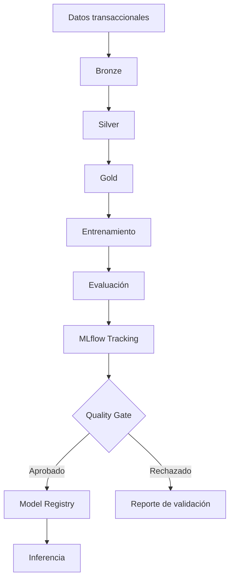

# MLOps Validation Toolkit

Toolkit modular para automatizar el procesamiento, entrenamiento, validación, versionamiento e inferencia de modelos de Machine Learning.

El proyecto integra PySpark, MLflow y GitHub Actions en un pipeline reproducible, con controles de calidad configurables y trazabilidad de experimentos. Como caso de aplicación, se utiliza un modelo de detección de fraude sobre transacciones bancarias sintéticas.

## Arquitectura



## Stack tecnológico

| Tecnología | Aplicación |
|---|---|
| Python | Desarrollo y orquestación del pipeline |
| PySpark | Procesamiento de datos |
| Spark SQL | Consultas y agregaciones |
| Parquet | Almacenamiento columnar |
| Scikit-learn | Entrenamiento y evaluación |
| MLflow | Experiment tracking y Model Registry |
| SQLite | Backend de metadatos |
| Pytest | Pruebas automatizadas |
| GitHub Actions | Integración continua |
| Azure ML | Configuraciones de referencia para despliegue |

## Estructura del proyecto

```text
mlops-validation-toolkit/
├── .github/
│   └── workflows/
│       └── ci.yml
├── toolkit/
│   ├── preprocessing.py
│   ├── validation.py
│   └── registry.py
├── configs/
│   ├── validation.yaml
│   └── validation_strict.yaml
├── azureml/
│   ├── model.yml
│   ├── endpoint.yml
│   └── deployment.yml
├── tests/
├── pipeline.py
├── inference.py
├── requirements.txt
└── README.md
```

## Procesamiento de datos

El pipeline implementa una arquitectura Medallion simplificada mediante PySpark.

| Capa | Responsabilidad |
|---|---|
| Bronze | Ingesta y persistencia de datos originales. |
| Silver | Deduplicación, tratamiento de nulos y validación de datos. |
| Gold | Feature engineering y preparación de variables para entrenamiento. |

Las transformaciones incluyen operaciones sobre DataFrames, consultas Spark SQL, agregaciones y broadcast joins. Las capas se persisten en formato Parquet.

## Toolkit de validación

El toolkit centraliza operaciones reutilizables del ciclo de vida de modelos:

- Validación de calidad y esquema de datos.
- Cálculo de métricas de clasificación.
- Comparación contra modelos baseline.
- Aplicación de quality gates configurables mediante YAML.
- Generación de reportes de validación.
- Registro de experimentos y artefactos.
- Versionamiento de modelos aprobados.

La separación entre configuración y lógica de implementación facilita la reutilización de los componentes en diferentes pipelines de Machine Learning.

## Resultados experimentales

El modelo candidato utiliza regresión logística con ponderación de clases y se compara contra un DummyClassifier.

Resultados obtenidos sobre un conjunto sintético de 1,000 transacciones, con evaluación sobre un subconjunto independiente:

| Métrica | Modelo candidato |
|---|---:|
| Precision | 0.3165 |
| Recall | 0.8621 |
| F1-score | 0.4630 |
| Average Precision | 0.4658 |
| Baseline Average Precision | 0.0967 |

El modelo candidato presenta una mejora respecto al baseline en Average Precision y un recall elevado. Sin embargo, su precision evidencia oportunidades de mejora relacionadas con la reducción de falsos positivos.

## Instalación

Requisitos:

- Python 3.11
- Java 17 o 21

```bash
python3.11 -m venv .venv
source .venv/bin/activate
python -m pip install -r requirements.txt
```

## Ejecución

Ejecutar las pruebas unitarias:

```bash
pytest -q
```

Ejecutar el pipeline completo:

```bash
python pipeline.py --rows 1000
```

Ejecutar una validación con criterios más restrictivos:

```bash
python pipeline.py \
  --rows 1000 \
  --config configs/validation_strict.yaml
```

El pipeline utiliza los siguientes códigos de salida:

| Código | Resultado |
|---|---|
| 0 | Validación aprobada |
| 2 | Quality gate rechazado |

Los modelos rechazados conservan sus métricas y evidencias en MLflow, pero no generan una nueva versión en Model Registry.

## Experiment tracking y Model Registry

MLflow permite gestionar:

- Parámetros y métricas de entrenamiento.
- Reportes y artefactos de validación.
- Model signatures y dependencias.
- Versionamiento de modelos.
- Alias de modelos aprobados.
- Trazabilidad de experimentos.

Para acceder a la interfaz local:

```bash
mlflow ui \
  --backend-store-uri sqlite:///mlruns/mlflow.db \
  --port 5000
```

Interfaz disponible en: http://127.0.0.1:5000

El alias `champion` identifica la versión seleccionada para inferencia.

## Inferencia

Ejecutar predicciones utilizando el modelo registrado:

```bash
python inference.py
```

Recuperar una versión específica:

```bash
python inference.py --version 1
```

Exponer el modelo mediante MLflow Serving:

```bash
export MLFLOW_TRACKING_URI=sqlite:///$(pwd)/mlruns/mlflow.db

mlflow models serve \
  -m 'models:/fraud-classifier@champion' \
  -p 5001 \
  --env-manager local
```

El servicio expone un endpoint HTTP para realizar predicciones en `/invocations`.

## Integración continua

El workflow de GitHub Actions automatiza:

- Configuración del entorno Python y Java.
- Instalación de dependencias.
- Ejecución de pruebas unitarias.
- Ejecución del pipeline.
- Verificación de quality gates.
- Publicación de reportes de validación.

El workflow admite ejecución mediante pull requests y activación manual. Una validación fallida interrumpe el flujo de promoción, conservando los reportes disponibles como evidencia.

## Integración propuesta con Azure

El proyecto incluye configuraciones de referencia para su adaptación a servicios administrados de Azure.

| Componente local | Equivalente en Azure |
|---|---|
| Spark local | Azure Databricks |
| Parquet y filesystem | ADLS Gen2 y Delta Lake |
| Ejecución del pipeline | Databricks Jobs |
| MLflow local | MLflow administrado |
| Model Registry | Azure Machine Learning |
| MLflow Serving | Managed Online Endpoints |
| Autenticación | Microsoft Entra ID y RBAC |
| Monitoreo | Azure Monitor |

El flujo propuesto contempla la ejecución del pipeline en Databricks, publicación de artefactos en ADLS, registro de modelos aprobados y despliegue mediante Azure Machine Learning.

Las configuraciones de Azure son referencias de integración y no corresponden a recursos desplegados.

## Alcance

El proyecto implementa un pipeline modular de MLOps con procesamiento de datos mediante PySpark, validaciones automatizadas, trazabilidad de experimentos, versionamiento de modelos e integración continua.

La implementación utiliza datos sintéticos y un entorno local reproducible, con configuraciones de referencia para su integración con Azure Databricks, ADLS Gen2 y Azure Machine Learning.